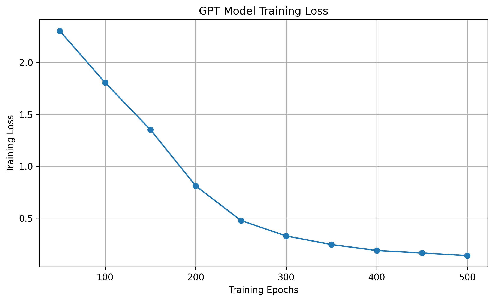

# My GPT – Built from Scratch

A small Generative Pre-trained Transformer (GPT) implementation built using Python and PyTorch, exploring the fundamentals of modern language models.

**Author:** Nidha Hussain  
**GitHub:** [nidhahaha24-debug](https://github.com/nidhahaha24-debug)

## Project Overview

This project explores how GPT-style language models work internally, from tokenization and embeddings to self-attention, transformer blocks, training, and text generation.

The model was trained on a small character-level text corpus using Google Colab GPU.

## Key Features

- Character-level vocabulary construction and encoding/decoding
- Byte Pair Encoding (BPE) tokenizer implementation
- Token embeddings and positional embeddings
- Scaled dot-product self-attention
- Multi-head self-attention
- Causal attention masking
- Transformer blocks with residual connections and layer normalization
- Next-token prediction and text generation
- GPU-based model training using PyTorch

## Model Architecture

The GPT model consists of:

1. Character-level input tokens
2. Token embeddings
3. Positional embeddings
4. Transformer blocks
   - Multi-head self-attention
   - Feed-forward neural network
   - Residual connections
   - Layer normalization
5. Final normalization
6. Vocabulary projection layer for next-token prediction

## Technologies Used

- Python
- PyTorch
- NumPy
- Google Colab
- CUDA GPU

## Training Configuration

| Parameter | Value |
|---|---:|
| Context length | 32 |
| Embedding dimension | 64 |
| Transformer blocks | 2 |
| Attention heads | 4 |
| Batch size | 16 |
| Training epochs | 500 |
| Learning rate | 0.001 |
| Optimizer | AdamW |
| Training device | CUDA GPU |

## Training Results

The model's training loss decreased during the 500 training epochs.

| Epoch | Training Loss |
|---:|---:|
| 50 | 2.3022 |
| 100 | 1.8044 |
| 150 | 1.3518 |
| 200 | 0.8107 |
| 250 | 0.4763 |
| 300 | 0.3277 |
| 350 | 0.2452 |
| 400 | 0.1878 |
| 450 | 0.1640 |
| 500 | **0.1387** |


### Training Loss Visualization

The graph below shows how the training loss decreased over 500 epochs.



## Sample Generated Output

The model generated text resembling its training corpus:

```text
Artificial intelligence is changing the world.
Machine learning helps computers learn from data.
Deep learning uses neural networks.
```

It also produced imperfect variations, demonstrating that the small model is still limited in its language-generation ability.

## How to Run

### 1. Clone the repository

```bash
git clone https://github.com/nidhahaha24-debug/neetcode-gpt.git
cd neetcode-gpt
```

### 2. Install dependencies

```bash
pip install -r requirements.txt
```

### 3. Run the training and generation demo

Use the Google Colab training notebook in the `notebooks/` directory when added to this repository. Select a GPU runtime and execute the notebook cells in order.

## Model Checkpoint

The trained model was saved as `my_gpt_model.pth`.

The checkpoint contains the model weights, vocabulary mappings, and architecture configuration. The checkpoint is not included in the repository; it can be generated by running the training workflow.

## Learning Outcomes

Through this project, I explored:

- How tokenization converts text into numerical representations
- How embeddings represent tokens and their positions
- How self-attention captures relationships between tokens
- How transformer blocks process sequential information
- How backpropagation and optimizers train neural networks
- How autoregressive models generate text one token at a time

## Future Improvements

- Train on a larger and more diverse text dataset
- Implement validation and test loss tracking
- Improve tokenization and text preprocessing
- Experiment with model dimensions and transformer depth
- Add model checkpoint loading and inference scripts

---

**Note:** This is an educational, small-scale GPT implementation. It demonstrates core transformer concepts and is not intended to match the capabilities of large production language models.
